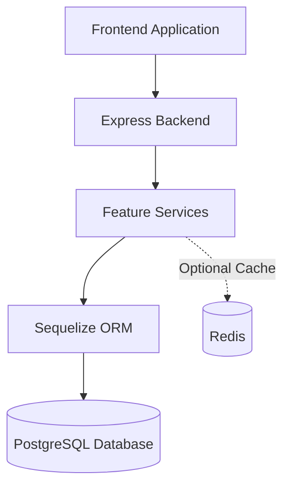
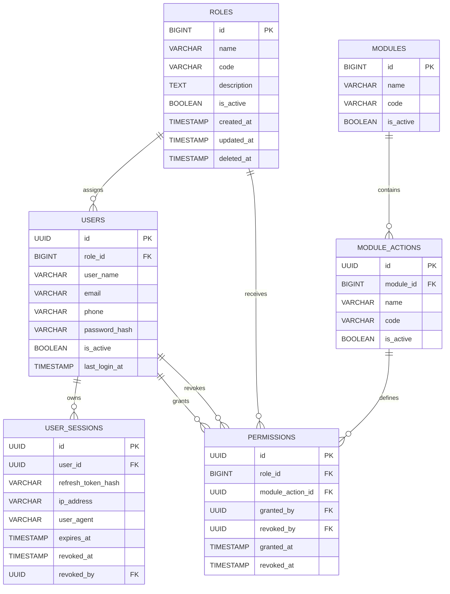

# 09. Database Design

## 1. Overview

The application uses PostgreSQL as its primary relational database and Sequelize as its ORM.

The database design follows a relational structure with foreign keys, constraints, migrations, and model associations to maintain data integrity.

## 2. Database Architecture

- PostgreSQL is the primary source of truth.
- Sequelize manages database models and relationships.
- Migrations manage schema changes.
- Redis is an optional caching layer.

## 3. Current Entity Relationship Diagram

The following ER diagram represents the currently implemented database models and their associations.

## 4. Table Responsibilities

| Table | Responsibility |
|---|---|
| `roles` | Stores application roles |
| `users` | Stores user accounts and role assignments |
| `user_sessions` | Tracks active, expired and revoked sessions |
| `modules` | Defines application modules |
| `module_actions` | Defines actions available within modules |
| `permissions` | Stores role-wise module action permissions |

## 5. Relationship Rules

- One role can be assigned to multiple users.
- One user can have multiple sessions.
- One module can contain multiple actions.
- One role can have multiple permission records.
- Each permission references a module action.
- Users are referenced as the permission grantor and revoker.

## 6. Database Conventions

1. Use primary keys for uniquely identifying records.
2. Use foreign keys to maintain relational integrity.
3. Use appropriate data types based on the data.
4. Use unique constraints where duplicate values are not allowed.
5. Use migrations for all schema changes.
6. Use database transactions for operations involving multiple related records.
7. Use timestamps for record tracking where applicable.
8. Apply soft deletion only where required.
9. Store passwords and refresh tokens as hashes, never as plain text.
10. Keep PostgreSQL as the source of truth.

## 7. Future Database Expansion

New hotel modules will introduce additional entities and relationships as their workflows are designed.

Planned database areas include:

- Rooms and Accommodation
- Reservations and Guests
- Restaurant and POS
- Kitchen and Recipes
- Inventory and Procurement
- Housekeeping
- Finance and Accounting
- Staff Management
- Reports and Analytics

Future schema changes must follow the same relational design principles and be introduced through migrations.

**Note:** This document describes the current database implementation. Future module tables and relationships will be documented when their schemas are designed.