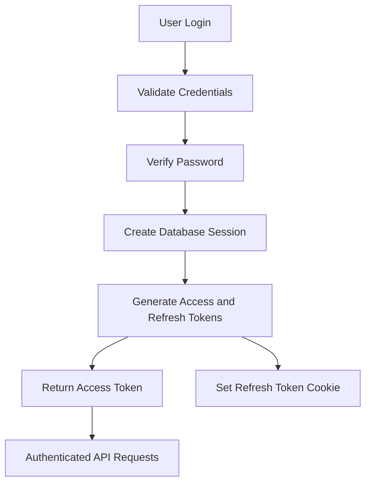

# 12. Authentication & Authorization Standards

## 1. Purpose

This document defines authentication, session management, and role-based authorization standards based on the existing implementation.

## 2. Authentication Architecture

The application uses JWT-based authentication with database-backed session management.

**Core components:**

- JWT Access Token
- JWT Refresh Token
- PostgreSQL `user_sessions`
- HTTP-only Refresh Token Cookie
- Authentication Middleware

### Authentication Flow



## 3. Token Standards

### Access Token

- Generated after successful login.
- Sent through the `Authorization` header.
- Uses the Bearer token scheme.
- Contains user and session identification claims.
- Verified through authentication middleware.
- Used for accessing protected APIs.

Example:

```http
Authorization: Bearer <access_token>
```

### Refresh Token

- Generated during login.
- Stored as a hash in the database.
- Delivered through an HTTP-only cookie.
- Never exposed in the normal JSON response.
- Rotated whenever a refresh operation succeeds.
- Previous token hashes are retained for reuse detection.

## 4. Session Management

The `user_sessions` table manages authenticated user sessions.

Important fields:

- `id`
- `user_id`
- `refresh_token_hash`
- `previous_refresh_token_hash`
- `expires_at`
- `revoked_at`
- `revoke_reason`
- `revoked_by`
- `ip_address`
- `user_agent`
- `last_active_at`

### Session Rules

1. Create a session after successful authentication.
2. Store only hashed refresh tokens.
3. Rotate refresh tokens within the existing session.
4. Reject expired or revoked sessions.
5. Revoke sessions during logout.
6. Support revocation of all sessions for a user.
7. Detect refresh token reuse and revoke the affected session.

Supported revocation reasons:

- `logout`
- `admin`
- `reuse_detected`
- `user_inactive`

## 5. Authentication Middleware

The `authenticate` middleware protects authenticated endpoints.

Responsibilities:

1. Extract the Bearer access token.
2. Verify token validity.
3. Identify the associated session.
4. Verify that the session is active and not expired.
5. Fetch the latest user record from PostgreSQL.
6. Verify that the user account is active.
7. Attach authenticated user information to `req.user`.
8. Attach the session identifier to `req.sessionId`.

The database remains the source of truth for current user information.

## 6. Authorization Architecture

The application follows Role-Based Access Control (RBAC).

Authorization is based on:

- Roles
- Modules
- Module Actions
- Role Permissions

Each role receives specific action-level permissions for different application modules.

Example:

| Module | Action | Hotel Manager |
|---|---|---|
| Users | VIEW | Granted |
| Users | CREATE | Granted |
| Users | DELETE | Denied |
| Roles | VIEW | Granted |
| Permissions | GRANT | Denied |

### Permission Identification

Permissions use the following format:

```text
MODULE_CODE:ACTION_CODE
```

Example:

```text
USERS:VIEW
USERS:CREATE
ROLES:UPDATE
PERMISSIONS:GRANT
```

## 7. Authorization Middleware

Two authorization methods are implemented:

**`authorize(moduleCode, actionCode)`**

- Checks a specific module and action permission.
- Used when an endpoint requires explicit action-level authorization.

**`authorizeResource(moduleCode)`**

- Determines the required action from the HTTP method.
- Applies resource-level authorization to an entire router.

HTTP method mapping:

| HTTP Method | Required Action |
|---|---|
| GET | VIEW |
| HEAD | VIEW |
| POST | CREATE |
| PUT | UPDATE |
| PATCH | UPDATE |
| DELETE | DELETE |

Authentication must execute before authorization.

## 8. Permission Caching

Redis is used to cache role-based permissions.

**Cache key format:**

```text
permissions:role:<roleId>
```

Standards:

- PostgreSQL remains the source of truth.
- Cache permissions role-wise in Redis.
- Use a configurable cache TTL.
- Invalidate the affected role cache after permission changes.
- Invalidate all role caches when module or module-action changes require it.
- Fall back to PostgreSQL when Redis is unavailable.
- Never grant access when permission verification fails.

## 9. Permission Management Rules

- Administrators manage permissions through role-based assignments.
- Grant and revoke operations must validate the target role and module action.
- Use database transactions for permission changes.
- Invalidate permission caches after successful transactions.
- Maintain grant and revoke history.
- Prevent changes that would leave permission management without any active authorized user.

## 10. Authentication APIs

| Method | Endpoint | Purpose |
|---|---|---|
| POST | `/api/auth/login` | Authenticate user |
| POST | `/api/auth/refresh` | Rotate tokens |
| POST | `/api/auth/logout` | Revoke current session |
| GET | `/api/auth/me` | Retrieve current user |
| GET | `/api/auth/me/permissions` | Retrieve current role permissions |

## 11. Security Rules

1. Never store plain-text passwords.
2. Use bcrypt for password hashing and verification.
3. Store refresh token hashes instead of raw tokens.
4. Use HTTP-only cookies for refresh tokens.
5. Validate active sessions on protected requests.
6. Never trust frontend authorization checks.
7. Do not expose password hashes or sensitive authentication data.
8. Return appropriate 401 and 403 responses.
9. Use centralized error handling.
10. Do not expose internal errors in production responses.

---

**Reference:** Existing Authentication, User Sessions, Authorization Middleware, and Permission Management implementations.