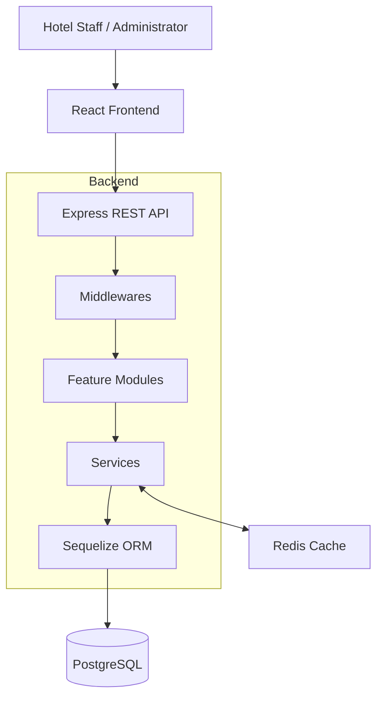
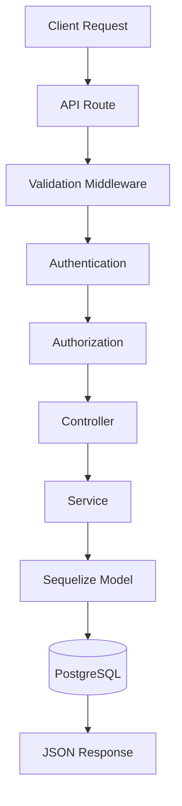

# 07. Project Architecture

## 1. Overview

The Hotel Management System follows a **feature-based modular monolith architecture** with separate frontend and backend applications.

The architecture is designed to keep business modules independent, reusable, and maintainable while supporting the expansion of the complete hotel management ecosystem.

## 2. High-Level Architecture



PostgreSQL is the primary data source. Redis is used as an optional caching layer.

## 3. Frontend Architecture

The frontend uses React with a feature-based structure.

```text
client/src/
├── app/
├── assets/
├── components/
├── constants/
├── features/
│   ├── auth/
│   └── access-management/
│       ├── users/
│       ├── roles/
│       ├── modules/
│       └── permissions/
├── hooks/
├── layouts/
├── lib/
├── routes/
└── services/
```

**Responsibilities:**

- `app/` – Application initialization and providers.
- `features/` – Feature-specific pages, components, hooks and logic.
- `components/` – Shared UI components.
- `layouts/` – Application layouts.
- `routes/` – Route configuration and navigation.
- `services/` – Backend API communication.
- `hooks/` – Reusable React hooks.
- `lib/` – Shared libraries and configurations.
- `constants/` – Application-wide constants.

## 4. Backend Architecture

The backend follows a feature-based modular structure using Express and Sequelize.

```text
server/
├── config/
├── database/
│   └── migrations/
├── features/
│   ├── auth/
│   └── access-management/
│       ├── users/
│       ├── roles/
│       ├── userSessions/
│       ├── modules/
│       ├── moduleActions/
│       └── permissions/
├── middlewares/
├── models/
├── routes/
├── utils/
└── server.js
```

**Responsibilities:**

- `features/` – Feature-specific routes, controllers, services and validators.
- `config/` – Database, Redis, authentication and access-control configuration.
- `database/` – Database migrations and related setup.
- `middlewares/` – Authentication, authorization and error handling.
- `models/` – Sequelize models and database associations.
- `routes/` – Central API route registration.
- `utils/` – Shared utilities and application helpers.

## 5. Backend Request Lifecycle



The request passes through applicable middleware before reaching the controller. The service handles business operations and database interactions.

Errors are forwarded to centralized error-handling middleware.

## 6. Authentication and Authorization

The application uses session-based authentication with JWT access and refresh tokens.

- Access tokens authenticate API requests.
- Refresh tokens are stored securely in HTTP-only cookies.
- Active sessions are maintained in PostgreSQL.
- Role-based permissions control access to protected resources.
- Redis caches role permissions to reduce repeated database queries.
- PostgreSQL remains the source of truth for permissions.

## 7. Database Architecture

PostgreSQL is the primary relational database, managed through Sequelize ORM.

- Database schema changes are managed through migrations.
- Sequelize models represent database entities.
- Model associations define relationships between entities.
- Transactions are used for operations requiring data consistency.
- Soft deletion is used where required.

## 8. Architectural Principles

- Feature-based modular organization.
- Separation of frontend and backend responsibilities.
- Reusable components and shared utilities.
- Centralized authentication, authorization and error handling.
- PostgreSQL as the primary source of truth.
- Redis as an optional performance layer.
- Consistent API communication between frontend and backend.

## 9. Future Architecture Direction

The architecture will evolve as additional hotel management modules are introduced, including:

- Reservations and Guest Management.
- Rooms and Housekeeping.
- Restaurant and Kitchen Operations.
- Inventory and Procurement.
- Finance and Accounting.
- Staff and Administration.
- Reports and Analytics.

The current modular monolith will remain the foundation. Multi-property support, SaaS capabilities and distributed services may be evaluated when business requirements justify them.

