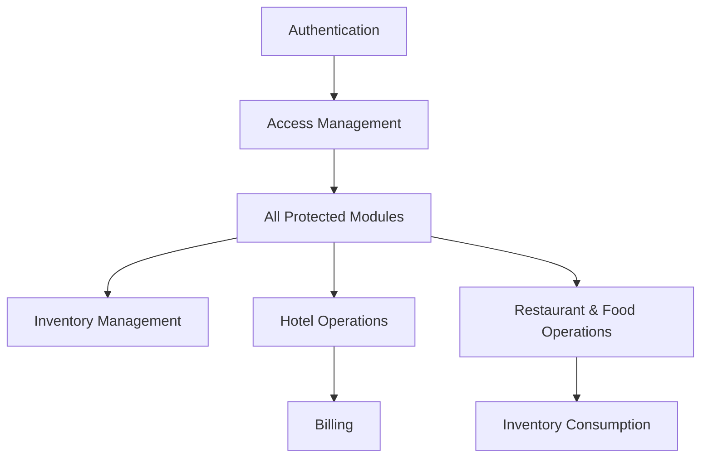

# 17. Module Documentation

## 1. Overview

The Hotel Management System follows a modular architecture. Each module manages a specific business area while sharing common authentication, authorization, and database infrastructure.

## 2. Current Modules

| Module | Responsibility |
|---|---|
| Authentication | Login, token management, and user sessions |
| Access Management | Users, roles, modules, actions, and permissions |
| Dashboard | Application overview entry point |

Access Management uses module-action-based permissions to control user access.

## 3. Planned Hotel Modules

| Module | Key Responsibilities |
|---|---|
| Inventory Management | Items, stock, suppliers, purchases, and inventory reports |
| Hotel Operations | Rooms, reservations, guests, check-in/out, and billing |
| Restaurant & Food Operations | Menu, POS, parcel orders, and recipe integration |

These modules will be implemented incrementally.

## 4. Module Dependencies

## 5. Integration Principles

- Each module must have a clearly defined responsibility.
- Modules should reuse shared authentication and authorization.
- Related modules must communicate through well-defined business logic.
- Database relationships must maintain data consistency.
- Cross-module workflows should avoid unnecessary duplication.

**Note:** The diagram represents the intended system architecture, not the current implementation status.