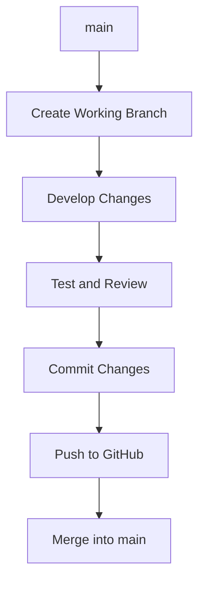

# 18. Git & Branching Strategy

## 1. Overview

Git and GitHub are used to track code changes, maintain development history, and collaborate safely through branches.

## 2. Branch Strategy

- `main` – Stable branch containing reviewed changes.
- `feature/<name>` – New features or module development.
- `bugfix/<name>` – Bug fixes.
- `docs/<name>` – Documentation-only changes.
- `hotfix/<name>` – Urgent fixes to stable code.

Create a separate branch for each independent task.

## 3. Development Workflow

## 4. Commit Convention

Use clear, meaningful commit messages:

`<type>: <short description>`

Common types:

- `feat` – New functionality
- `fix` – Bug fixes
- `docs` – Documentation changes
- `refactor` – Code restructuring
- `style` – Formatting changes
- `chore` – Maintenance tasks

Example: `feat: add role management frontend`

## 5. Best Practices

- Keep commits focused and descriptive.
- Pull the latest `main` before starting new work.
- Never commit `.env` files, secrets, or generated dependencies.
- Review changes before merging.
- Resolve merge conflicts carefully.
- Keep branches task-specific and remove merged branches when no longer needed.

**Note:** This document defines the recommended Git workflow. Branch protection and automated CI checks are not assumed to be configured.