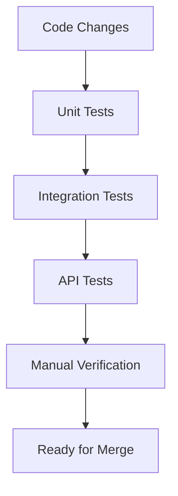

# 20. Testing Strategy

## 1. Objective

Ensure application reliability, data integrity, security, and correctness through structured testing.

## 2. Testing Levels

| Type | Purpose |
|---|---|
| Unit Testing | Test individual functions and business logic |
| Integration Testing | Verify service, database, and module interactions |
| API Testing | Validate endpoints, responses, status codes, and permissions |

## 3. Key Testing Areas

- **Authentication:** Login, token refresh, logout, and session validation.
- **Authorization:** Role permissions, access restrictions, and permission revocation.
- **Validation:** Invalid inputs, missing fields, and duplicate records.
- **Database:** Relationships, constraints, transactions, and rollback.
- **API:** Successful responses, error handling, and unauthorized requests.
- **Frontend:** Form validation, loading states, error states, and user interactions.

## 4. Testing Flow

## 5. Current Status

- Frontend: ESLint and production build checks are available.
- Backend: Automated test suite is not configured.
- Unit, integration, and API tests are planned.

**Note:** Testing frameworks, test scripts, and automated test coverage will be introduced incrementally as development progresses.