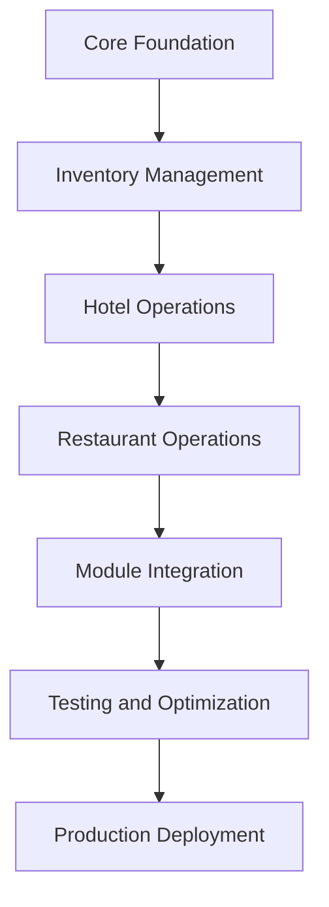

# 22. Roadmap and Future Enhancements

## 1. Current Foundation

The application currently includes:

- Authentication
- Dashboard
- Role and User Management
- Module and Module Action Management
- Permission Management
- PostgreSQL database integration

The remaining business modules will be developed incrementally.

## 2. Planned Modules

| Module | Planned Features |
|---|---|
| Inventory Management | Item Master, Categories, Stock, Purchases, Suppliers, Stores, Recipes, Expiry Tracking |
| Hotel Operations | Room Management, Reservations, Guest Management, Check-in, Check-out, Billing |
| Restaurant Operations | Menu Management, Food Ordering, POS, Parcel Orders, Recipe Integration |

## 3. Future Enhancements

- **Reporting:** Operational reports, summaries and business analytics.
- **Audit Logs:** Track important user activities and data changes.
- **Notifications:** System alerts and operational notifications.
- **Security:** Improve API protection, validation and access control.
- **Testing:** Introduce automated unit, integration and API tests.
- **Deployment:** Configure production hosting and CI/CD workflows.
- **Performance:** Optimize database queries, caching and application response times.

## 4. Development Priority

## 5. Long-Term Direction

The goal is to develop a unified, modular Hotel Management System that manages the complete hotel workflow through interconnected modules and a shared database.

**Project Scope:** Single-hotel management system. Multi-hotel support may be considered in a future phase.